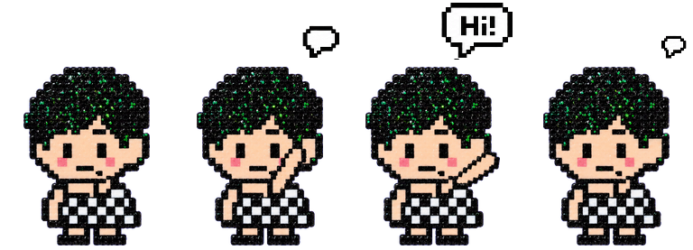
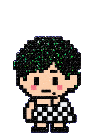

# 打招呼气泡

桌宠加载素材时把 `design.png` 中的三个像素气泡合成到第 3 行的原始四帧中：无气泡 → 小气泡 → Hi! → 缩小的空气泡。保留原人物像素、动作与帧时长。

标准图集维持 192×208、8 列 9 行，供原有 Codex Pet 使用。独立桌宠把所有动作帧顶部统一补 69 像素透明留白，使用 192×277 的完整帧播放，避免切换动作时人物缩放或脚底跳动。气泡已画入帧，不使用额外窗口或浮层。缺少或尺寸不符的可选气泡素材时回退原始帧。

`design.png` 是批准的 ImageGen 设计稿；只提取气泡，不替换稿中重绘的人物。`GreetingFrames` 中记录了与该素材对应的裁切区域。更换设计稿时应同步更新区域并重新验证。

验证与预览导出：在仓库根目录运行 `DEVELOPER_DIR=/Library/Developer/CommandLineTools ./desktop-app/tests/run-greeting-tests.sh`，然后运行原有 `run-work-tests.sh` 回归测试。
